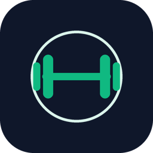
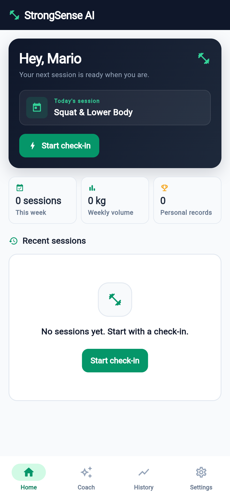
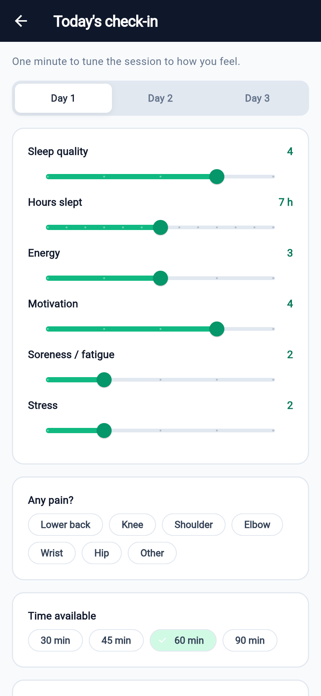
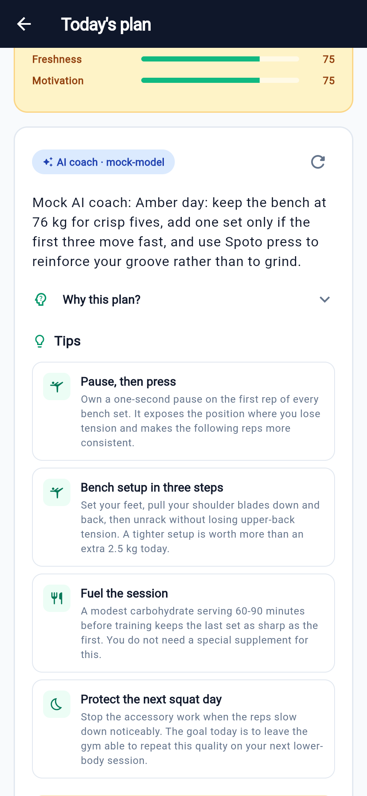
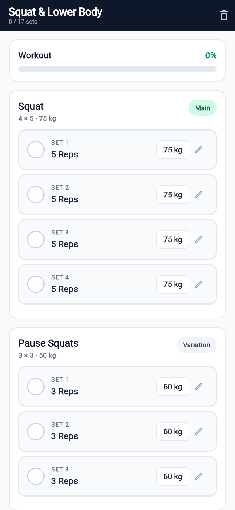
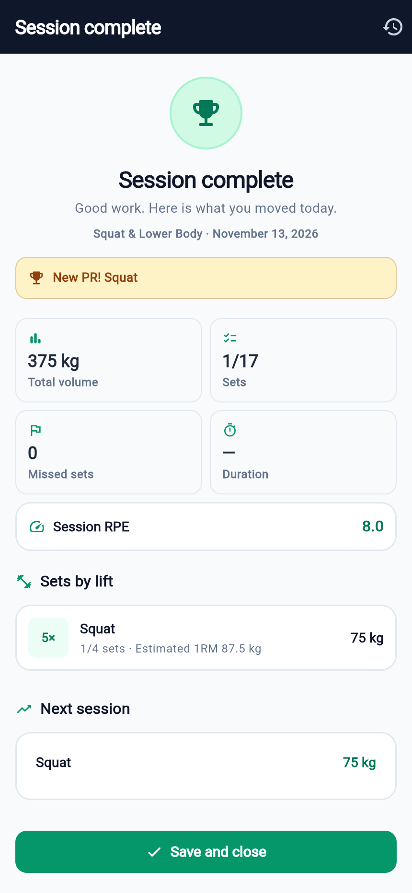
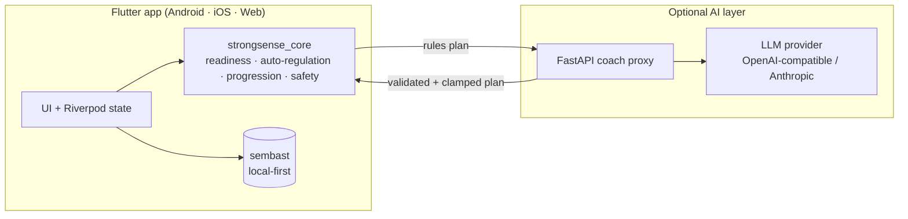

<div align="center">
  
  <h1>StrongSense AI</h1>
  <p><strong>Powerlifting training that adapts to how you feel.</strong></p>
  <p>
    <a href="https://github.com/mariopp126/strongsense-ai/actions/workflows/ci.yml"></a>
    <a href="LICENSE"></a>
    
    
  </p>
</div>

StrongSense AI is a **powerbuilding / powerlifting training app** built around the
three competition lifts — **bench press, squat and deadlift** — with the original
3-day program (plus accessories) from the design reference.

It asks how you feel before training, looks at how your last session actually went,
and adjusts the session: load, volume, RPE ceiling, substitutions and a deload when
your body (or your calendar) says so. Coaching tips are **offline-first**; an optional
LLM layer adds richer advice without ever being trusted with the final numbers.

<p align="center">
  
  
  
  
  
</p>

## Why StrongSense

Most trackers record what you did. StrongSense decides **what you should do today**:

| Input | What the app does |
|---|---|
| Pre-session check-in (sleep, energy, motivation, soreness, stress, pain, time) | Computes a 0–100 **readiness score** with a green/amber/orange/red band and explains it. |
| How the **last session** went (RPE, missed reps, classification) | Applies the auto-regulation matrix: push, hold, reduce or deload. |
| Pain flags by joint | Holds or reduces load, swaps in a safe variation, and blocks progression on the affected lift. |
| Time available | Trims accessories instead of rushing rest periods. |
| Optional LLM | Adds coaching tips and a second opinion **clamped by deterministic safety bounds**. |

## The 3-day program

| Day | Focus | Main lift | Accessories |
|---|---|---|---|
| 1 | Lower body | Squat | Pause squats, leg press, leg extensions, calf raises |
| 2 | Upper body | Bench press | Spoto press, chest-supported rows, lat pulldowns, triceps, curls |
| 3 | Full body | Deadlift | Goblet squats, hamstring curls, DB shoulder press, lateral raises |

Work sets, reps and starting loads are seeded exactly as in the reference design.
Progress is carried forward automatically from what you actually lifted.

## Features

- **Readiness check-in** with weighted scoring, pain caps and explainable components.
- **Auto-regulation matrix** covering green/amber/orange/red readiness × easy/normal/hard last session.
- **Smart deloads**: week 4, red readiness, severe pain, or repeated hard missed sessions.
- **Pain-aware substitutions** (shoulder, lower back, knee, hip, elbow, wrist).
- **AI coach (optional)**: OpenAI-compatible or native Anthropic, with a server-side proxy, structured output validation and hard safety clamps.
- **Live workout**: set-by-set logging, weight/reps/RPE editing, rest timer, resumable sessions.
- **Session summary**: volume, e1RM, missed sets, duration, PR detection, next-session targets.
- **History & progress**: session log plus e1RM line chart and volume bar chart.
- **Local-first**: sembast on device/IndexedDB in the browser; no account required.
- **Mobile + web**: Flutter for Android, iOS and an installable PWA.
- **English + Spanish**, kg/lb, light/dark theme.
- **Material 3 design** carried over from the original React reference (slate + emerald).

## Architecture



- **The app owns every training decision.** `packages/strongsense_core` is pure Dart and
  always produces a complete plan offline.
- **The server never invents rules.** It builds a prompt from structured training data,
  validates the model's JSON, applies the same safety bounds and returns a plan.
- **AI proposes, rules dispose.** The client re-clamps every AI plan before applying it;
  if the server or network fails, training continues with the offline plan.

Design details are in [`docs/architecture.md`](docs/architecture.md) and the ADRs in
[`docs/adr/`](docs/adr).

## Repository layout

```
.
├── apps/strongsense/          Flutter app (Android, iOS, Web)
├── packages/strongsense_core/ Pure-Dart domain: models, engines, contract codec
├── server/coach_api/          Python 3.12 FastAPI coach proxy
├── docs/                      Architecture, data model, AI/safety, design system, contract, ADRs
├── scripts/                   dev.ps1, set_keys.ps1, smoke_coach.py, check_llm.py, generate_icons.py
└── .github/workflows/ci.yml   Core, app, Android, server and secrets-guard jobs
```

## Getting started

### Prerequisites

| Tool | Version |
|---|---|
| Flutter | 3.50+ (Dart 3.14+) |
| Python | 3.12+ |
| Android SDK / Xcode | only for mobile builds (iOS builds need macOS) |

### 1. Run the app (web)

```powershell
cd apps/strongsense
flutter pub get
flutter run -d chrome --web-port 5173
```

The app works immediately with the offline coach — no server or key required.

### 2. Run the AI coach server (optional)

```powershell
cd server/coach_api
python -m venv .venv
.\.venv\Scripts\Activate.ps1
pip install -r requirements-dev.txt
Copy-Item .env.example .env
# open .env and add your provider key + model
uvicorn app.main:app --host 127.0.0.1 --port 8080
```

Then in the app: **Settings → AI coach → Enable**, set the URL
(`http://127.0.0.1:8080`) and press **Test connection**.

> Android emulator: the app automatically rewrites `localhost` to `10.0.2.2`.
> Physical device: run the server with `--host 0.0.0.0` and use your LAN IP.

### 3. Try the coach API directly

```powershell
python scripts/smoke_coach.py --base-url http://127.0.0.1:8080
```

The smoke test fails if the server returns `source: rules_fallback` (the provider
failed); pass `--allow-fallback` only when you intentionally test the offline path.

Probe the configured provider key/model without starting the API:

```powershell
python scripts/check_llm.py
python scripts/check_llm.py --json
```

`check_llm.py` reports `auth_rejected`, `model_not_found`, `quota_exceeded`,
`timeout`, `network` and the other failure categories, and never prints the key.

## AI coach configuration

Keys live **only** in `server/coach_api/.env` (gitignored). The app never sees them.
`scripts/set_keys.ps1` writes the file without echoing the key.

| Variable | Purpose |
|---|---|
| `LLM_PROVIDER` | `openai_compatible` or `anthropic` |
| `LLM_BASE_URL` | Provider base URL |
| `LLM_API_KEY` | Your key |
| `LLM_MODEL` | Model id |
| `LLM_FALLBACK_*` | Optional second provider used when the first fails |
| `COACH_API_TOKEN` | Optional bearer token to protect the proxy |
| `ALLOWED_ORIGINS` | CORS allowlist (defaults to localhost:5173) |
| `MAX_REQUESTS_PER_MIN` | Per-client rate limit (default 30) |
| `DATABASE_URL` | PostgreSQL URL enabling the optional plan cache; empty = in-memory cache only |
| `CACHE_TTL_SECONDS` | Cache entry TTL in seconds; default 86400 (24h), 0 disables expiry |

Ready-to-use `LLM_BASE_URL` values:

| Provider | Base URL |
|---|---|
| OpenAI | `https://api.openai.com/v1` |
| DeepSeek | `https://api.deepseek.com/v1` |
| OpenRouter | `https://openrouter.ai/api/v1` |
| Groq | `https://api.groq.com/openai/v1` |
| Gemini (OpenAI-compatible) | `https://generativelanguage.googleapis.com/v1beta/openai/` |
| Ollama (local) | `http://127.0.0.1:11434/v1` |
| Anthropic (native) | `https://api.anthropic.com` |

## Backup, export and import

**Settings → Data** gives you full ownership of the local data:

- **Export backup (JSON)** — settings, program, sessions and coach plans in one
  versioned `strongsense.backup` file. Web/desktop downloads or saves it; Android/iOS
  opens the system share sheet.
- **Export sessions (CSV)** — one row per set, ready for Excel or Google Sheets.
- **Import backup (JSON)** — validates the whole file first, then lets you **Merge**
  (keep current settings/program, add the newest sessions/plans) or **Replace**
  (use the backup for everything).

The format and conflict rules are documented in
[`docs/data-model.md`](docs/data-model.md#backup-format).

## Testing

```powershell
# Pure-Dart domain core
cd packages/strongsense_core
dart analyze --fatal-infos
dart test

# Flutter app
cd apps/strongsense
flutter analyze --fatal-infos
flutter test

# FastAPI service
cd server/coach_api
.\.venv\Scripts\ruff check .
.\.venv\Scripts\mypy app
.\.venv\Scripts\pytest --cov=app --cov-fail-under=85
```

CI runs the same commands plus `flutter build web --release` and
`flutter build apk --debug` on every push and pull request.

## Safety & privacy

- Every AI plan is validated and **clamped twice** (server and client). See
  [`docs/ai-coach.md`](docs/ai-coach.md) and the shared contract fixtures in
  [`docs/contract/`](docs/contract).
- The app sends only structured training data — no names, emails or device IDs.
- AI coaching is opt-in. Offline coaching is the default and is free.
- **StrongSense AI provides general training guidance, not medical advice.** Stop and
  seek professional care if you feel sharp pain, numbness or a joint gives way.

## Roadmap

- [ ] Program editor (custom days, exercises and set schemes)
- [ ] Accounts + multi-device sync
- [ ] Session reminders / rest notifications
- [ ] More programs (5/3/1, GZCLP, block periodization)
- [ ] Export/import and CSV reports
- [ ] Wearable/HR integration

## License

[MIT](LICENSE) © 2026 Mario Pucheu.
