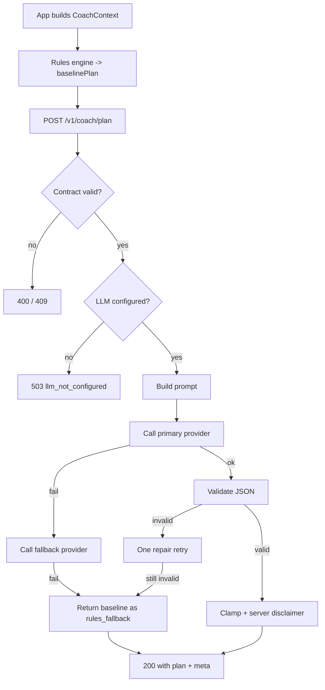

# AI coach

The AI layer is **optional enrichment**. The app can plan and run every session
without it. This document explains what the server sends, what it accepts back, and
why the model can never produce an unsafe session.

## Roles

| Layer | Owns | Cannot |
|---|---|---|
| `strongsense_core` (Dart) | Readiness, matrix, deload, progression, substitutions, safety bounds | Call the network |
| Flutter app | Presenting plans, user overrides, local persistence | Trust model output without clamping |
| FastAPI service (Python) | Prompting, provider calls, JSON validation, server-side clamp | Decide training rules or persist data |
| LLM | Wording, prioritisation, extra tips | Change a load beyond the clamp, add exercises, invent a disclaimer |

## Request pipeline

Client behavior: the baseline plan is rendered immediately; the AI request runs in the
background. If it fails, the baseline stays and a non-blocking notice appears. The
client clamps the AI plan again before applying it.

## What is sent

Structured training data only — no names, emails, device ids, free-text notes or
location:

- Date, block week, unit.
- Program day: exercise ids, names, roles and prescribed sets.
- Check-in: five 1–5 scores, sleep hours, pain areas/severity, time available.
- Readiness: score, band and component scores.
- Last session for that day: classification, top set/RPE/e1RM/missed sets per lift.
- Up to six recent session summaries.
- Personal records.
- Increments and the contract constraints.

Example payload: [`contract/coach-request.example.json`](contract/coach-request.example.json).

## Prompt

**System** (server-side, fixed):

- You are an expert strength coach for drug-free powerlifting/powerbuilding.
- Evidence-based, concise, practical; match the requested locale.
- Respect the RPE cap and load/set bounds.
- Never diagnose or treat injuries; when pain is present, prefer substitution or rest.
- Return **only** JSON that matches the provided schema.
- The disclaimer is supplied by the server; do not write your own.

**User**: a compact JSON block with the context, the deterministic baseline plan, and
the task ("improve and explain, stay inside the bounds").

## Output contract

`CoachPlan` v1 (full field table in [`contract/contract.md`](contract/contract.md)):

- `summary`, `readinessExplanation` (≤ 600 chars each).
- `rpeCap` (6.5–9.0 normal, ≤ 7.0 deload).
- `deload` boolean.
- `adjustments[]` — `exerciseId`, `exercise`, `loadDeltaPct`, `setsDelta`,
  `repsHint`, `reason`, optional `substituteWith`.
- `tips[]` — title/body/category.
- `flags[]`.
- `disclaimer` — always replaced with the server constant.

## Validation and clamping

Applied on the server (`safety.py`) and again on the client (`SafetyBounds.clamp`):

| Rule | Effect |
|---|---|
| Unknown `exerciseId` | Adjustment dropped |
| `loadDeltaPct` | Normal clamp to −10…+5; deload to −40…0; rounded to 0.5 |
| `setsDelta` | −2…+2 |
| `rpeCap` | 6.5…9.0; ≤ 7.0 when deload |
| Pain rule | If `painSeverity ≥ 4` and the lift loads a flagged joint, no positive load delta |
| Deload rule | Forced when block week % 4 == 0, pain ≥ 7, or red readiness |
| Tips | Max 12, title ≤ 80, body ≤ 480 chars |
| Summary/explanation | ≤ 600 chars |
| Flags | Max 8, ≤ 160 chars |
| Disclaimer | Always replaced by the server-owned constant |
| Adjustment count | Max 12 |

The shared fixture [`contract/unsafe-ai-output.example.json`](contract/unsafe-ai-output.example.json)
is loaded by **both** the Dart and Python test suites to prove the two clamps agree.

## Fallback ladder

1. Primary provider (openai-compatible or Anthropic), 2 attempts with backoff.
2. Optional fallback provider, same policy.
3. One JSON repair retry if the model returned text that is not valid JSON.
4. If a baseline plan was supplied, return it as `source: "rules_fallback"` with
   `meta.clamped` / `droppedAdjustments`.
5. Otherwise `503 llm_unavailable`.

The client treats any non-200 response, timeout or invalid body as "AI unavailable"
and keeps its local plan.

## Providers

`LLM_PROVIDER=openai_compatible` works with any `/chat/completions` endpoint (OpenAI,
DeepSeek, Groq, OpenRouter, Together, Gemini-compatible, Ollama). `LLM_PROVIDER=anthropic`
uses the native Messages API. Both adapters share the same prompt and validation path.
An optional fallback chain is configured with `LLM_FALLBACK_*`.

| Setting | Default | Notes |
|---|---|---|
| `LLM_TIMEOUT_SECONDS` | 20 | Total budget per provider call |
| `LLM_TEMPERATURE` | 0.4 | Enough variation for wording, not for numbers |
| `LLM_MAX_TOKENS` | 900 | Keeps responses inside the contract |

JSON schema mode is attempted first (`response_format: json_schema`); if the provider
rejects it, the adapter falls back to `json_object` plus a strict instruction.

## Key handling

1. `Copy-Item server/coach_api/.env.example server/coach_api/.env`
2. Fill `LLM_API_KEY` (and optionally the fallback).
3. Or run `scripts/set_keys.ps1`, which prompts without echoing the key.

`.env` is gitignored, CI fails if it is tracked, and the key is never logged. The app
only knows the server URL.

## Privacy & retention

- No user accounts and no server database: nothing is stored server-side.
- Logs contain request id, route, status, provider, model and latency only.
- AI coaching is opt-in in Settings; disabling it sends nothing.
- The payload preview is documented in the README; the exact context is in
  `CoachContext.toJson`.

## Safety

- The disclaimer is injected by the server; model text cannot replace it.
- Severe pain (≥ 7) forces a deload and a stop-the-lift flag on the client.
- The model cannot add exercises that are not in the session, cannot exceed the
  clamp, and cannot write the disclaimer.
- The feature is general training guidance, not medical advice.

## Testing

- Python: `respx` mocks HTTP; tests cover 429/5xx/timeout, malformed JSON, schema
  violations, the unsafe fixture, fallback, auth, rate limiting, oversize bodies.
- Dart: `CoachService` tests use a fake client; the unsafe fixture is clamped twice.
- Contract tests load the same example files in both languages.

## Known limitations

- Free-text session notes are not sent to the model in v0.1 (privacy-first default).
- A model can still produce weak advice; the clamp guarantees safety, not quality.
- Latency is provider-dependent (typically 1–8 s). Training never waits on it.
