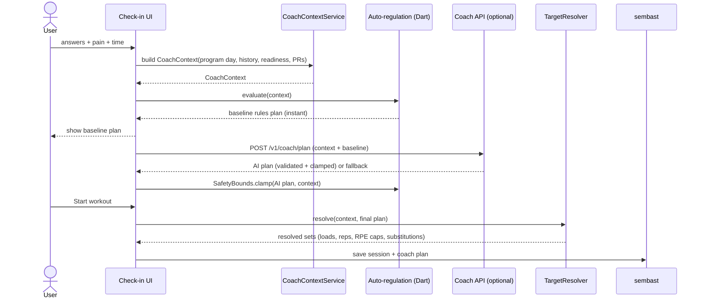

# Architecture

## Overview

StrongSense AI has three deployable parts:

| Part | Technology | Responsibility |
|---|---|---|
| App | Flutter 3.41 / Dart 3.11 | UI, navigation, local persistence, deterministic training logic, offline coaching |
| Domain core | Pure Dart package | Models, readiness, auto-regulation, progression, safety bounds, contract codec |
| Coach API | Python 3.12 / FastAPI | Optional LLM proxy: prompt building, provider calls, validation, clamping, and an optional PostgreSQL plan cache. |

The design principle is **offline-first, rules-first**:

1. The app can run a complete session with no network and no key.
2. The server is an *enrichment* layer; it never decides whether training can happen.
3. Every AI value is clamped by deterministic bounds before it is applied.

## Layers in the Flutter app

```
lib/
├── core/          Design system, router, responsive shell, shared widgets, formatters
├── data/          sembast database, repositories, coach API client, coach services
├── domain/        (thin) re-exports of strongsense_core used by UI
├── features/      Screen-level widgets (onboarding, home, checkin, workout, summary, coach,
│                  history, settings, program)
├── l10n/          AppLocalizations (English + Spanish, synchronous, no codegen)
└── state/         Riverpod providers + state controllers
```

Rules:

- Widgets never touch `sembast` directly; they go through repositories.
- Widgets never call HTTP directly; they go through `CoachService`.
- Training math never lives in widgets.

## Session data flow



## Readiness & auto-regulation

The full algorithm lives in `packages/strongsense_core/lib/src/engines/`.

1. **Readiness score** — weighted check-in (sleep 30 %, energy 25 %, stress 20 %,
   soreness 15 %, motivation 10 %), sleep-hours modifier, pain caps at 59 / 34.
2. **Last-session classification** — `easy` (no misses, avg RPE ≤ 7.5), `normal`
   (≤ 8.5), `hard` (missed reps or higher RPE), `none` on the first session.
3. **Matrix** — band × classification maps to a load delta, main-set delta,
   accessory-set delta and an RPE ceiling.
4. **Deload detection** — week 4, red readiness, severe pain, or hard sessions with
   missed reps under orange/red readiness.
5. **Pain guidance** — joint mapping, substitutions, load never increases on an
   affected lift.
6. **Time budget** — under 45 min drop the last accessory; under 30 min keep main
   lifts and variations only.
7. **Target resolution** — the base load is the load actually used last time (scaled
   to preserve back-off structure), then the plan delta is applied and rounded to the
   lift's increment.
8. **Progression** — after a session, all reps hit at RPE ≤ 8 → +2.5 %; ≤ 1 missed set
   at RPE ≤ 9 → repeat; otherwise −2.5 %.

## AI flow

See [`ai-coach.md`](ai-coach.md) for the full contract. In short:

1. The app sends **structured summaries only** (no names, no free-text notes).
2. The server builds a system + user prompt, calls the model with a JSON schema, and
   validates the response.
3. The server drops unknown exercises, clamps numeric values, truncates text and injects
   the medical disclaimer.
4. The client parses, re-clamps and applies the plan.
5. Any failure falls back to the offline plan with a visible notice.

## Storage

`sembast` with four stores (see [`data-model.md`](data-model.md)):

| Store | Key | Value |
|---|---|---|
| `settings` | `app` | `AppSettings` JSON |
| `programs` | `default` | `TrainingProgram` JSON |
| `sessions` | session id | `Session` JSON |
| `coach_plans` | session id | `{generatedAt, plan}` |

On mobile the database is a file in the application documents directory; on web it is
IndexedDB via `sembast_web`. Platform selection uses a conditional import so the web
bundle never references `dart:io`.

## State management

Riverpod 2 (`flutter_riverpod`), no code generation:

- `settingsControllerProvider` — persisted settings.
- `programControllerProvider` — the seeded (and later editable) program.
- `sessionControllerProvider` — the active session; save-on-change.
- `historyProvider` — completed sessions; invalidated after finish/discard.
- `latestCoachPlanProvider` — most recent saved plan.
- Derived: `nextDayProvider`, `personalRecordsProvider`, `weeklyStatsProvider`,
  `hasActiveSessionProvider`.

## Server

FastAPI app in `server/coach_api/app/`:

```
main.py        app factory, CORS, body-size guard, request-id middleware, routes
config.py      pydantic-settings, env validation, key redaction
schemas.py     request/response models (Pydantic v2)
prompt.py      system + user prompt construction
llm.py         provider adapters, retries, JSON decoding, repair retry
safety.py      clamp implementation + server-owned disclaimer
coach.py       orchestration and fallback ladder
cache.py       optional in-memory/PostgreSQL plan cache with TTL
auth.py        optional bearer token
ratelimit.py   in-memory token bucket
logging.py     structured logs without bodies or secrets
```

The service is stateless **by default**: no database and no saved sessions. When
`DATABASE_URL` is set, an optional PostgreSQL plan cache (`coach_plan_cache`)
stores SHA-256-keyed coaching responses so identical requests do not re-trigger
the LLM. The cache is disabled by default (in-memory only), expires entries after
`CACHE_TTL_SECONDS` (default 24 hours, 0 disables expiry), never stores
`rules_fallback` responses, and closes its connection pool on shutdown.

## Deployment

- App: `flutter build web --release` → any static host; Android APK/AAB; iOS via macOS.
- Server: Docker or `uvicorn`. For anything beyond localhost, terminate TLS, set
  `COACH_API_TOKEN`, restrict `ALLOWED_ORIGINS`, and keep the key in a secret store.
  Set `DATABASE_URL` to a PostgreSQL instance to enable the optional plan cache, and
  `CACHE_TTL_SECONDS` to control how long cached plans are kept (default 86400s).
- CORS defaults to `http://localhost:5173`, matching `flutter run --web-port 5173`.

## Testing strategy

- **Core**: pure unit tests, no Flutter; shared contract fixtures from `docs/contract/`.
- **App**: repository tests on an in-memory sembast, coach-service tests with a fake
  client, and a widget test for onboarding.
- **Server**: FastAPI `TestClient` + `respx`; no network. Coverage gate 85 %.
- **CI**: five jobs (core, app, Android, server, secrets guard).

## Extending

- New program day/exercise: change `ProgramSeed` and the tests.
- New auto-regulation rule: add it to `AutoregulationEngine`, cover it with a matrix
  test, and update the contract fixtures if the wire shape changes.
- New provider: implement the provider protocol in `llm.py`; no app changes needed.
- New screen: add a `GoRoute` and a feature folder; keep business logic in core/services.
